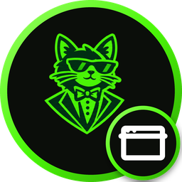
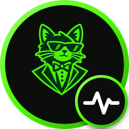

<p align="center">
  <picture><source media="(prefers-color-scheme: dark)" srcset="https://global.media.stuxedo.com/logo-light.png"><source media="(prefers-color-scheme: light)" srcset="https://global.media.stuxedo.com/logo-dark.png"></picture>
</p>

# Stuxedo Status

### *The landing page for Stuxedo's status pages, at [status.stuxedo.com](https://status.stuxedo.com).*

## Overview

Stuxedo has two status pages, and this page asks which one you want:

| | Button | Page | Covers |
| --- | --- | --- | --- |
|  | **Stuxedo Web Status** | [status.stuxedo.dev](https://status.stuxedo.dev) | Websites, email and web hosting |
|  | **Stuxedo Server Status** | [status.stuxedo.net](https://status.stuxedo.net) | The servers behind every region ([Stuxedo/Status](https://github.com/Stuxedo/Status)) |

The Server Status button also shows the servers' overall status, read in the browser from the
`data/summary.json` that [GitHup](https://github.com/StuxGroup/GitHup) publishes in Stuxedo/Status.

## Features

- Two big panel buttons on a pinstriped background, each with its own badge icon
- Live overall server status on the Server Status button
- Light and dark themes (follows the OS, with a toggle that remembers your choice)
- A changelog page, the Boring Legal Stuff hub and its six pages, a sitemap and a 404 page
- A static site with no build step, deployed to GitHub Pages by `.github/workflows/pages.yml`

## Icons

The two badge icons in `assets/img/` are built by `scripts/badge-icons.py` (Pillow) from Stuxedo's
`icon-light.png`:

```bash
python -I scripts/badge-icons.py stuxedo icon-light.png assets/img
```

## Local preview

Run `./dev-server.sh` (or `dev-server.bat`, add a port as the last argument) to serve the site at
`http://127.0.0.1:8000` the way GitHub Pages does, with the dev-mode banner on. Add `--no-dev-mode`
to see it exactly as production does. It uses PHP 7.4's built-in server (set `PHP_BIN` to pick
another PHP).

## Contributing

See [CONTRIBUTING.md](CONTRIBUTING.md).

## Versioning

This project is pre-stable, so it uses [Semantic Versioning](https://semver.org) on `0.x.y`. Its
first stable release will be its first [Date Version](https://datevers.ing) (`YY.MM.DD`, the UTC
release date, with `-1`, `-2`… for later releases the same day), and there will be no 1.0.0. See
[CHANGELOG.md](CHANGELOG.md) for what changed in each release.

Releases are made and tagged on `test`, and go live when its pull request into `main` is merged (see [CONTRIBUTING.md](CONTRIBUTING.md#branches)).

## License

Copyright (c) 2026 Stux.Group. All rights reserved.

---

*Built & Maintained by <picture><source media="(prefers-color-scheme: dark)" srcset="https://global.media.stuxedo.com/icon-light.png"><source media="(prefers-color-scheme: light)" srcset="https://global.media.stuxedo.com/icon-dark.png"></picture> [Stuxedo](https://github.com/Stuxedo).  
Stuxedo is a part of the <picture><source media="(prefers-color-scheme: dark)" srcset="https://global.media.stux.group/icon-light.png"><source media="(prefers-color-scheme: light)" srcset="https://global.media.stux.group/icon-dark.png"></picture> Stux.Group brand of businesses.*
